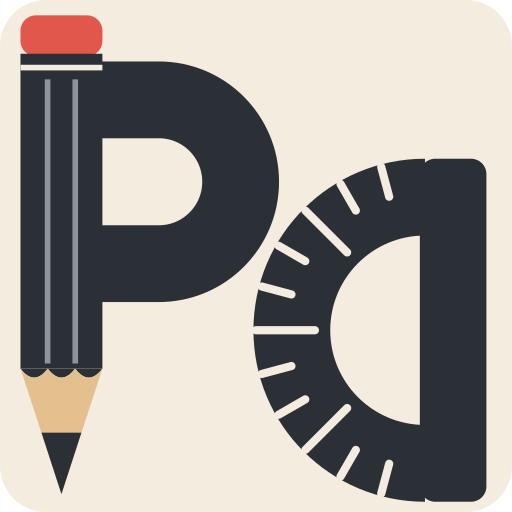

#  Pretty Drafter

A browser-based whiteboard for teaching, studying, and explaining ideas —  
built for pen input and geometry.

## Compatibility

Pretty Drafter is a web app, so there is nothing to install.  
Just open it in your browser:

https://pdmulenko.github.io/pretty-drafter/

## Features

- Pen-based drawing (tablet and mouse friendly)
- Basic drawing tools (pencil, marker for thick lines, line, highlighter, text) with the ability to undo the last drawing
- White color works as a temporary eraser that paints over content
- Text tool (Helvetica Neue / Arial): thickness buttons switch light / regular / bold; the text frame can be moved, resized and rotated while typing
- Editing tools: eraser, hand (moves the whole board; content pushed past the edge is dropped) and area selection (cut a fragment of the active layer, then move, resize or rotate it)
- Toolbar blocks wrap onto new lines on narrow screens
- The `?` button shows the app info and all keyboard shortcuts
- Geometric shapes (polyline, rectangle, triangle, circle, trapezoid, parallelogram) with editing support (rotation and resize handles)
- Solids (cube / cuboid, triangular and hexagonal prisms, triangular, quadrilateral and hexagonal pyramids) drawn as in textbooks, with hidden edges dashed
- Functions (parabola, hyperbola, sine wave) whose graphs fit the frame you drag
- Images can be inserted from the clipboard
- Three-layer canvas with the ability to clear layers and toggle their visibility
- Keyboard shortcuts (see below)

## Input

- Works best with graphic tablets
- Fully usable with mouse and trackpad

## Keyboard shortcuts

- `D` — cycle drawing tools
- `E` — cycle editing tools (eraser, hand, selection)
- `Ctrl + Z` — undo the last drawing (except for eraser)
- `Ctrl + C` / `Cmd + C` — copy the current selection
- `Ctrl + V` / `Cmd + V` — paste the copied selection next to the original, or insert an image from clipboard
- `G` — cycle geometry tools
- `S` — cycle solids
- `F` — cycle functions
- `Shift` — hold for angle snapping (line), a square (rectangle), an equilateral triangle (triangle), or a square frame (solids and functions, e.g. a true cube)
- `X` — cancel the current shape or image; for a selection, put the fragment back where it was (`Esc` is not used: in macOS full screen it exits full screen)
- `Enter` — finish editing the current shape, image or selection
- `Delete` / `Backspace` — delete the current selection or image
- Text: `Enter` places the text, `Shift + Enter` starts a new line
- `T` — cycle thickness for the current drawing tool or geometry shape
- `C` — cycle colors for the current drawing tool or geometry shape
- `1`–`3` — switch to a layer
- `Shift + 1`–`3` — toggle layer visibility
- `Ctrl + 1`–`3` — clear a layer
- `?` — show or hide the help window

## Tests

Serve the folder locally (ES modules need http), for example
`python3 -m http.server 8765`, and open http://127.0.0.1:8765/tests/.
The page loads the board in a frame, runs all scenarios with synthetic
pointer and keyboard events and shows the results.

## Release history

See [CHANGELOG](CHANGELOG.md).

## Credits

Toolbar icons: [Tabler Icons](https://tabler.io/icons) (MIT License).
Icons for polyline, parallelogram, trapezoid, solid shapes and functions are drawn in the same style.

## 📄 License

[MIT](LICENSE)
